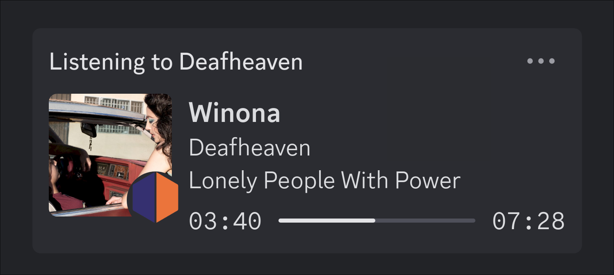
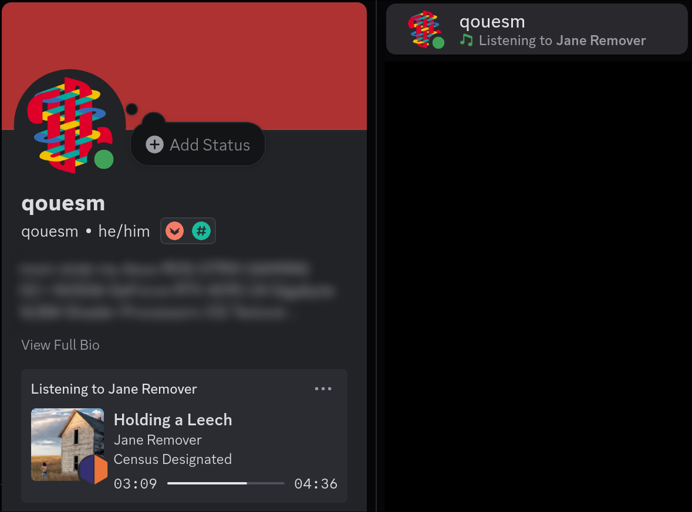

# ARCHIVED

This plugin has always had issues for other users. 
I built this to work with the [Navidrome](https://www.navidrome.org/) scrobbler using all MusicBrainz tagged music and other setups may not work, resulting in the plugin crash when it couldn't find an MBID.
The official [Navidrome rich presence plugin ](https://github.com/navidrome/discord-rich-presence-plugin)fully replaces the functionality I personally wanted out of what I was originally trying to do with this plugin, and with better features such as pause support, something I don't believe to be possible due to the way ListenBrainz works and the API endpoints available.

As such, I'm archiving this repository. I don't have the time, drive, or know-how to address the issues others have opened. I barely know how to handle PR's on Github as I'm not a full-time developer.  If you use Navidrome, this should still work, but I would recommend the Navidrome plugin instead. You're welcome to fork this and address the error handling so this works better for you. [The Equicord project did this already](https://equicord.org/plugins/RichPresence), though they never asked me for permission to incorporate this code (not that I have any problems with that).

Feel free to ask me any questions on Discord @qouesm. I may not be very knowledgeable, as this is mostly a fork of the Vencord Last.FM plugin anyway. Just get to the point or I'll flag your message as spam and ignore it:

https://nohello.net/

https://dontasktoask.com/

---

# Vencord ListenBrainz Rich Presence Plugin

This plugin will display a ListenBrainz user's playing now song as a rich presence status.
It is largely based off the work of the [Last.FM plugin](https://github.com/Vendicated/Vencord/blob/main/src/plugins/lastfm/index.tsx) provided officially by [Vencord](https://vencord.dev/).

This plugin must be manually compiled and installed onto a Vencord client.
Details for this can be found in their docs:
- https://docs.vencord.dev/installing/
- https://docs.vencord.dev/installing/custom-plugins/

### See also:
https://github.com/qouesm/listenbrainz-discord-presence
